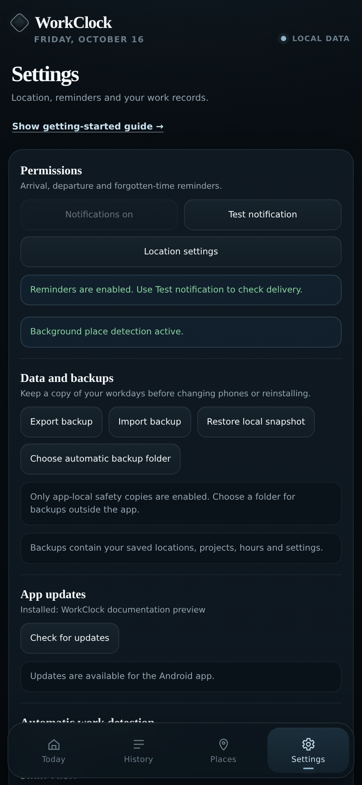

# Back up your records

Your hours, projects, places and settings are kept on the phone. Make a separate copy before changing phones or uninstalling the app.

To save a copy:

1. Open **Settings → Data and backups**.
2. Tap **Export backup**.
3. Save the JSON file somewhere you can find it later.

To restore it, tap **Import backup** and choose the file. Existing records will be replaced, so check the file before confirming.

**Choose automatic backup folder** can save daily copies to an Android folder you select. WorkClock also keeps a few local safety snapshots, but those are not a substitute for a file outside the app.

Updating a signed WorkClock release normally keeps your data. Uninstalling the app can erase local records, so export a backup first.
