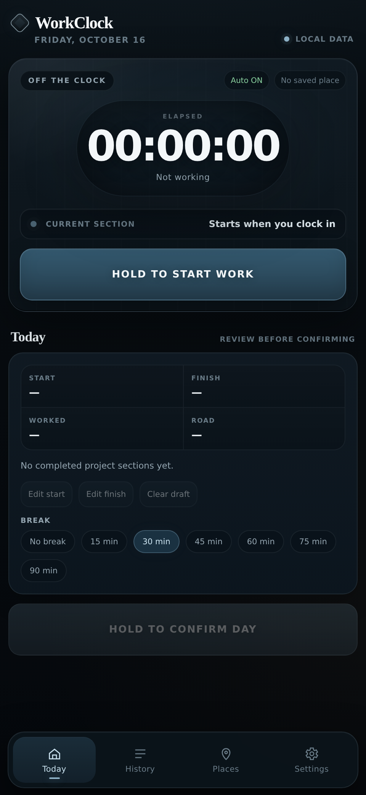

# Get started

Install the [latest WorkClock APK](https://github.com/mrtherichart/Workclock/releases/latest), then open the app.

You can start recording hours immediately. Hold **Start work** when your day begins. The timer uses the saved start time, so you don't need to keep the app open.

For automatic arrival and departure reminders:

1. Open **Places** and save at least one home or workplace. See [Save places](places.md).
2. Grant precise location and background location access when Android asks.
3. Open **Settings** and enable notifications. Use **Test notification** to check them.

You can use WorkClock without location access. You'll just enter the times and journeys yourself.

WorkClock doesn't automatically confirm your work hours from GPS. You check each day before saving it.
