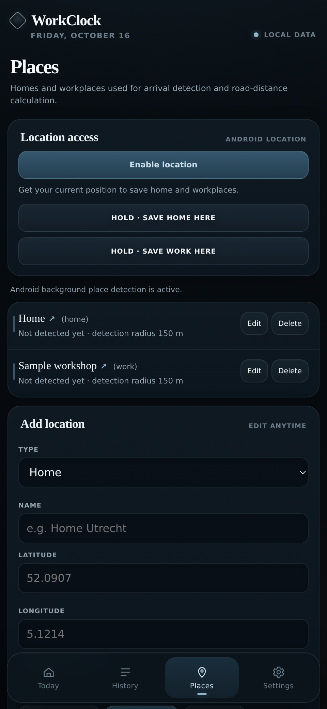

# Save places

Saved locations help WorkClock recognise when you reach or leave work. They also provide start and end points for road-distance calculations.

1. Go to **Places** and tap **Enable location**.
2. While you're physically at home or work, wait for a location fix.
3. Hold **Save home here** or **Save work here**.
4. Give the place a recognisable name if needed.

To enter a place without being there, use **Add location** and enter its coordinates manually. You can change the detection radius there too.

Your places appear in a list. Tap a **place name and the arrow** to open it in your usual Maps app. Use **Edit** if the pin isn't quite right.

For background reminders, Android needs precise and background location permission. Recognition can be delayed and depends on the phone's location and battery settings. WorkClock doesn't follow your journey continuously.
