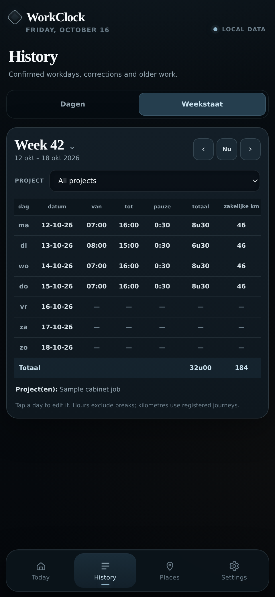

# Fill in a weekly work slip

1. Open **History → Weekstaat**.
2. Use the arrows for the previous or next week. Tap **Week 42** (or whichever number appears) to jump to another week.
3. If you need hours for one job, choose the **Project** filter.
4. Copy each row onto your paper work slip: day, date, start, finish, break, hours and kilometres.

The totals are at the bottom. Days without records show dashes.

**Need to correct something?** Tap the day's row to edit it. You can also switch to **Dagen** to see the full records.

Project filtering divides breaks proportionally between recorded project sections. Shared travel kilometres aren't assigned to a single project when a day contains several projects. Check these before copying a project-specific work slip.
