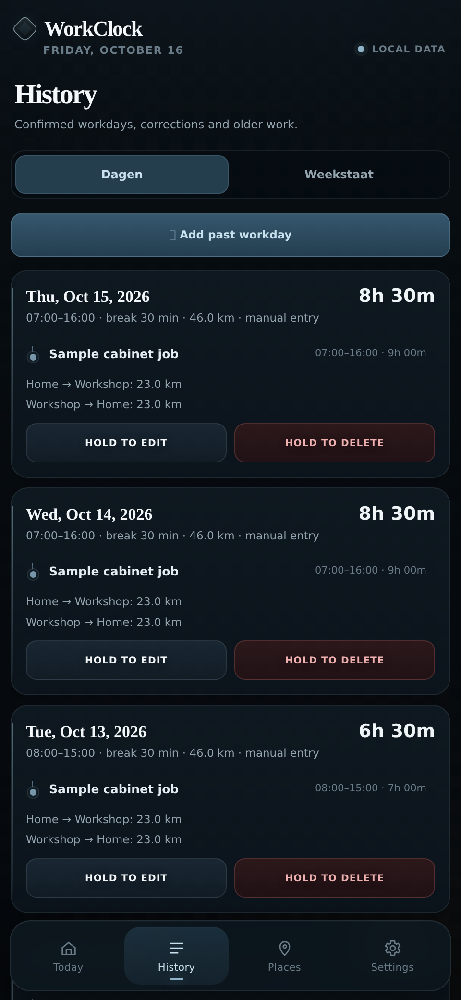

# Record a workday

1. Open **Today** and hold **Start work**.
2. When you finish, hold **Finish work**. If you've forgotten, choose an earlier or exact time.
3. Name the project you worked on. If you switched projects during the day, use **End project · Keep working** when you switch.
4. Check the times and break under **Today**.
5. Hold **Confirm day**. That moves the day into **History**.

**Fix a mistake:** Open **History → Dagen**, then edit the recorded day. To add a day you missed, use **Add past workday**. **Use previous workday** can fill in most of the details for you; check them before saving.

A day that is still running isn't an error. If a finished day needs confirmation or a return journey is missing, History may show **Review**.

The hours are stored on your phone. If a journey is still pending, opening WorkClock later at a saved home may let it complete the return distance.
